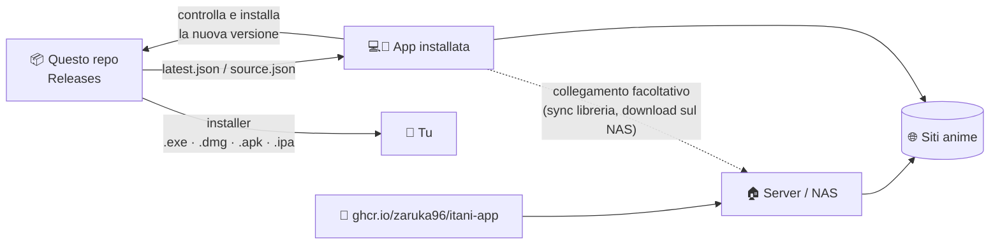

<p align="center"></p>

<h1 align="center">ITANI App</h1>

<p align="center"><b>Cerca, guarda e scarica anime da più siti italiani, da un'unica app.</b></p>

<p align="center">
  <a href="https://github.com/Zaruka96/ITANI-App-releases/releases/latest"></a>
  <a href="https://github.com/Zaruka96/ITANI-App-releases/releases"></a>
  <a href="https://github.com/users/Zaruka96/packages/container/package/itani-app"></a>
  <br>
  
  
  
  
</p>

<p align="center">
  <a href="https://github.com/Zaruka96/ITANI-App-releases/releases/latest"><b>⬇️ Scarica l'ultima versione</b></a> ·
  <a href="#-primo-avvio">🚀 Primo avvio</a> ·
  <a href="#-docker">🐳 Docker / NAS</a>
</p>

---

## 📌 Cos'è

**ITANI App** unisce i cataloghi di **AnimeWorld**, **AnimeSaturn** e **AnimeUnity** in una sola interfaccia: cerchi un anime, lo guardi in streaming e lo scarichi, mentre l'app tiene traccia degli episodi visti e scarica da sola quelli nuovi.
Gira su **Windows, macOS, Android (anche TV) e iOS**, oppure come **sito web in Docker** sul tuo NAS.

> Questo repository contiene solo **installer** e **file di aggiornamento automatico**: il codice sorgente non è pubblico.
> Nomi precedenti: “Anime Builder” (fino alla v1.2.00) e “ITANI Downloader” (fino alla v1.3).

## ✨ Funzionalità

- 🔎 **Ricerca per sito o globale**: tutti i siti in parallelo, lo stesso anime trovato su più siti diventa una sola card
- 🗂️ **Catalogo e filtri**: Ultimi, Popolari, In corso, Completati, Più votati; genere, anno, stagione, tipo, solo doppiati
- 🧩 **Raggruppa stagioni**: stagioni, film e OVA dello stesso anime in un'unica card
- ▶️ **Player integrato** (MP4 e HLS): salta sigla/ending (AniSkip), episodio successivo automatico, Picture-in-Picture, scorciatoie da tastiera
- 🛟 **Fonte di riserva**: se un sito non risponde, il player riproduce lo stesso episodio da un altro sito
- ⏯️ **Riprendi da dove eri**: episodi visti, posizione salvata, “Continua a guardare”
- 📚 **Libreria**: liste personalizzate, voto da 1 a 10 con nota, statistiche di visione
- ⬇️ **Download manager**: coda che sopravvive al riavvio, pausa/ripresa, tentativi automatici, download in parallelo, “Scarica stagione”
- 🔁 **Download programmati**: i nuovi episodi di un anime si scaricano da soli
- 🎞️ **Pronto per Jellyfin/Plex**: nomi `Anime/Season 01/Anime S01E01.mp4`, riordino delle cartelle già scaricate, refresh automatico della libreria Jellyfin
- 📅 **Calendario** delle uscite della settimana e avviso dei nuovi episodi
- 💡 **Consigliati per te**, serie correlate e tutte le stagioni/film del filone (AniList)
- 🔗 **AniList e MyAnimeList**: aggiornamento automatico del profilo AniList, importazione delle liste
- 🔔 **Notifiche** su ntfy o Telegram per nuovi episodi e download falliti
- 🏠 **Server ITANI** (Docker): sito con login, profili separati, libreria sincronizzata tra dispositivi, download direttamente sul NAS
- 📺 **Android TV / Google TV**: tutta l'app si usa con il telecomando
- 🛡️ **Verifiche Cloudflare** gestite in automatico (finestra interna nell'app, FlareSolverr in Docker)
- 🌙 **Tema Notte/Giorno**, interfaccia in italiano, aggiornamenti automatici
- 🔞 **Modalità 18+** facoltativa, solo dopo la conferma dell'età

### Siti supportati

| Sito | Lingua | Video |
|---|---|---|
| AnimeWorld | IT (sub e ITA) | MP4 diretto |
| AnimeSaturn | IT (sub e ITA) | MP4 / HLS |
| AnimeUnity | IT (sub e ITA) | HLS |

Gli indirizzi dei siti si cambiano in Impostazioni se un dominio cambia.

## ⬇️ Scarica l'ultima versione

Vai su **[Releases → Latest](https://github.com/Zaruka96/ITANI-App-releases/releases/latest)** e scegli il file per il tuo sistema:

| Sistema | File |
|---|---|
| 🪟 Windows 10/11 (x64) | `ITANI-App_<versione>_windows-x64-setup.exe` |
| 🍎 macOS (Apple Silicon e Intel) | `ITANI-App_<versione>_macos-universal.dmg` |
| 🤖 Android, telefono e TV (arm64 / armv7) | `ITANI-App_<versione>_android.apk` |
| 📱 iPhone / iPad (iOS 15+) | `ITANI-App_<versione>_ios-unsigned.ipa` (vedi sotto) |
| 🐳 Docker / NAS | `docker pull ghcr.io/zaruka96/itani-app:latest` ([istruzioni](#-docker)) |

## 🚀 Primo avvio

Le app non sono firmate con certificati Apple/Microsoft:

- **macOS**: dopo aver trascinato l'app in Applicazioni, clic destro sull'app → **Apri** → **Apri**. Se macOS dice che l'app è danneggiata: `xattr -dr com.apple.quarantine "/Applications/ITANI App.app"`.
- **Windows**: se compare SmartScreen, **Ulteriori informazioni** → **Esegui comunque**.
- **Android**: apri l'APK dal telefono e consenti l'installazione da origini sconosciute quando richiesto.
- **iOS**: l'IPA non è firmato. Installalo dal computer con [Sideloadly](https://sideloadly.io) o [AltStore](https://altstore.io) usando il tuo Apple ID; con un Apple ID gratuito l'app va reinstallata ogni 7 giorni.

## 🔄 Aggiornamenti

| Dove | Come |
|---|---|
| Windows, macOS | Direttamente dall'app: controllo a ogni avvio o da **Impostazioni → Aggiornamenti** (pacchetti firmati, verificati prima dell'installazione). |
| Android | L'app avvisa e scarica il nuovo APK, che si installa sopra mantenendo i dati. In alternativa, installa il nuovo file da questa pagina. |
| iOS | Tramite SideStore: aggiungi una volta la fonte `https://github.com/Zaruka96/ITANI-App-releases/releases/latest/download/source.json` (anche da Impostazioni → Aggiornamenti → “Aggiungi a SideStore”). Oppure reinstalla il nuovo IPA da questa pagina. |
| Docker | Aggiorna l'immagine (vedi [Aggiornare](#aggiornare)). |

## ⚙️ Come funziona



- L'app legge i siti, risolve il video e lo riproduce o lo scarica; i link video non vengono mai salvati (scadono).
- Da **Impostazioni → Server ITANI** l'app può collegarsi al tuo sito Docker: stessa libreria su tutti i dispositivi e download direttamente sul NAS.

## 🧱 Stack tecnologico

| Livello | Tecnologie |
|---|---|
| Interfaccia | React 19, TypeScript, Tailwind CSS 4, hls.js |
| App | Tauri 2 (Windows, macOS, Android, iOS) |
| Backend | Rust (tokio, reqwest, axum) |
| Docker | server Rust `itani-web` + ffmpeg su `debian:bookworm-slim`, FlareSolverr |
| Servizi esterni | AniList, AniSkip, ntfy, Telegram, Jellyfin |

## 🐳 Docker

ITANI App gira anche come **sito web con login** in un container (pensato per un server di casa o un NAS, es. TrueNAS): stessa interfaccia dell'app, usabile da PC, telefono o TV, con download che finiscono direttamente sul NAS e download programmati sempre attivi.

| | |
|---|---|
| Immagine | `ghcr.io/zaruka96/itani-app` (tag `latest` e `<versione>`, es. `1.23.1`) |
| Architettura | `linux/amd64` |
| Porta | `8080` (HTTP) |
| Dentro | server Rust `itani-web` (senza Tauri né display) + interfaccia + `ffmpeg` |
| Accanto | [FlareSolverr](https://github.com/FlareSolverr/FlareSolverr) per superare le verifiche Cloudflare |

### Avvio veloce

```bash
docker run -d --name itani-app -p 8080:8080 \
  -e ITANI_APP_PASSWORD="una-password-lunga" \
  -v ./itani-config:/config -v ./anime:/downloads \
  ghcr.io/zaruka96/itani-app:latest
```

Poi apri `http://<server>:8080` e accedi con `admin` e la password scelta. Senza FlareSolverr i siti dietro Cloudflare (AnimeSaturn) funzionano solo finché non chiedono la verifica: per l'uso normale meglio il compose qui sotto.

### docker-compose.yml

Su TrueNAS: **Apps → Discover Apps → ⋮ → Install via YAML** e incolla il file (crea entrambi i servizi). Altrove: `docker compose up -d`. Cambia **password** e **percorsi** prima di avviarlo.

```yaml
services:
  itani-app:
    image: ghcr.io/zaruka96/itani-app:latest
    # a ogni avvio (Stop → Start, Edit → Save) scarica l'ultima versione pubblicata
    pull_policy: always
    container_name: itani-app
    restart: unless-stopped
    # utente/gruppo proprietari di impostazioni e file scaricati (su TrueNAS: apps = 568)
    user: "568:568"
    ports:
      - "8080:8080"
    environment:
      # credenziali di accesso al sito: CAMBIALE (senza password il container non parte)
      ITANI_APP_USERNAME: "admin"
      ITANI_APP_PASSWORD: "cambia-questa-password"
      # AnimeSaturn è dietro Cloudflare: le verifiche le supera FlareSolverr (qui sotto)
      FLARESOLVERR_URL: "http://flaresolverr:8191"
      TZ: "Europe/Rome"
    volumes:
      # impostazioni, coda download, libreria condivisa
      - /mnt/pool/apps/itani-app:/config
      # cartella dei download: il tuo dataset
      - /mnt/pool/media/anime:/downloads
      # cartella dei film (facoltativa: senza, i film vanno in /downloads)
      - /mnt/pool/media/anime-film:/movies
    depends_on:
      - flaresolverr

  # browser vero, senza interfaccia, che risolve le verifiche Cloudflare per conto del sito
  # (raggiungibile solo dagli altri container: nessuna porta esposta)
  flaresolverr:
    image: ghcr.io/flaresolverr/flaresolverr:latest
    container_name: flaresolverr
    restart: unless-stopped
    environment:
      LOG_LEVEL: "info"
      TZ: "Europe/Rome"
```

### Variabili d'ambiente

| Variabile | Predefinito | A cosa serve |
|---|---|---|
| `ITANI_APP_PASSWORD` | — **obbligatoria** | Password dell'amministratore. Senza, il container si ferma all'avvio. Se la cambi, le sessioni salvate vengono chiuse. |
| `ITANI_APP_USERNAME` | `admin` | Nome utente dell'amministratore (gli altri profili si creano da Impostazioni → Profili). |
| `FLARESOLVERR_URL` | vuota | Indirizzo di FlareSolverr (`http://flaresolverr:8191` nel compose). Vuota = nessun aiuto per le verifiche Cloudflare. |
| `ITANI_APP_PORT` | `8080` | Porta su cui ascolta il sito dentro il container. |
| `ITANI_APP_SECURE_COOKIE` | non impostata | `1` = cookie di sessione solo su HTTPS. Avviene già da solo dietro un reverse proxy che invia `X-Forwarded-Proto: https`. |
| `ITANI_APP_DATA_DIR` | `/config/xdg/data/com.zaruka.itani-app` | Dove salvare impostazioni, coda, libreria, profili e sessioni (dentro il volume `/config`). |
| `ITANI_APP_DOWNLOAD_DIR` | `/downloads` | Cartella predefinita delle serie. |
| `ITANI_APP_MOVIE_DIR` | `/movies` | Cartella dei film, usata solo se esiste (volume montato) e se nelle Impostazioni non ne hai scelta un'altra. |
| `ITANI_APP_WEB_DIR` | `/opt/itani-app/web` | Interfaccia compilata servita dal sito. Da non toccare. |
| `ITANI_APP_DOCKER` | `1` | Dice all'app che è in Docker: al posto dell'aggiornamento in-app mostra come aggiornare l'immagine. Da non toccare. |
| `TZ` | (UTC) | Fuso orario del container (log e orari). |

> I predefiniti della tabella sono quelli dell'immagine. FlareSolverr ha le sue variabili (nel compose: `LOG_LEVEL`, `TZ`).

### Volumi e porte

| Mount / porta | Contenuto |
|---|---|
| `/config` | Impostazioni, coda download, download programmati, libreria e profili. Deve essere scrivibile dall'utente di `user:`. |
| `/downloads` | Le serie scaricate: mappalo sul tuo dataset/cartella media. |
| `/movies` | Facoltativo: i film. Se non lo monti, i film vanno in `/downloads`. |
| `8080` | Il sito (HTTP). FlareSolverr non va esposto: nel compose non ha porte pubblicate. |
| `user: "568:568"` | Utente proprietario dei file (su TrueNAS `apps`). Cambialo con il tuo `UID:GID`. |

### Aggiornare

```bash
docker compose pull && docker compose up -d
```

Con `pull_policy: always` basta anche solo `docker compose up -d`; su TrueNAS **Stop → Start** (o Edit → Save). Il sito avvisa quando esce una nuova versione; il container non si aggiorna da solo. Impostazioni, coda e libreria restano in `/config`.

### Sicurezza

- Il sito parla HTTP: in casa va bene. Da fuori usa una **VPN** (Tailscale/WireGuard) o un **reverse proxy HTTPS** (Nginx Proxy Manager, Traefik…) verso la porta 8080.
- Usa una password lunga e unica: il sito può scaricare file sul tuo NAS. Dopo 5 tentativi sbagliati dallo stesso indirizzo l'attesa cresce fino a 15 minuti.

<details>
<summary>Arrivi da “Anime Builder” (ghcr.io/zaruka96/anime-builder)?</summary>

- Cambia l'immagine in `ghcr.io/zaruka96/itani-app:latest`: quella vecchia non riceve più versioni.
- Fino alla v1.3 la cartella di `/config` era `/mnt/pool/apps/anime-builder`: rinominala in `itani-app` prima di aggiornare, o lascia il vecchio percorso nel compose.
- Dalla v1.4 (prima era un desktop remoto sulla porta 5800) cambiano porta (`8080`), variabili di accesso (`ITANI_APP_USERNAME` / `ITANI_APP_PASSWORD` al posto di `WEB_AUTHENTICATION_*`), utente (`user:` al posto di `USER_ID`/`GROUP_ID`) e si aggiunge FlareSolverr: reinstalla con il nuovo compose tenendo lo stesso percorso per `/config`. Impostazioni e coda restano; la libreria della vecchia versione (salvata nel browser del desktop remoto) non viene trasferita.

</details>

---

<sub>Uso personale. Rispetta i termini dei siti e la normativa sul diritto d'autore.</sub>
